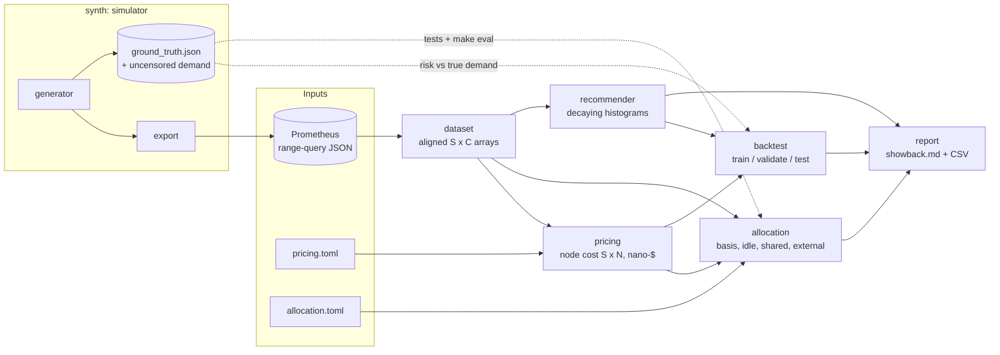

# costlens

Kubernetes cost allocation and rightsizing, computed offline from Prometheus range-query
exports.

costlens reads plain `/api/v1/query_range` JSON (usage, requests, limits, node capacity,
labels, OOM events), prices every node from a catalog, and splits the bill across namespaces,
teams, labels or workloads. Idle capacity and shared platform costs are distributed with a
configurable strategy. Money is kept as integer nano-dollars and split by largest-remainder
apportionment, so **allocated + idle + shared == total holds with `==`, not approximately**.
For each workload container it then produces VPA-style request recommendations (decaying
exponential histograms, percentile targets, safety margin, OOM-aware memory bumps) and
backtests the policies on held-out weeks. Results come out as a Markdown/CSV showback report.

**Who it's for:** platform and FinOps engineers who want showback numbers they can audit
line by line, and rightsizing advice that comes with its measured risk. It is a CLI and
library, not a hosted service. Everything runs offline against files, and nothing in it talks
to a live cluster.

> **Status:** portfolio project. The bundled data is synthetic: a simulated six-week,
> seven-node, multi-team cluster with a known ground truth. costlens has not been run against
> a production cluster. See [Limitations](#limitations).

## What's inside

| Capability | Where |
| --- | --- |
| Prometheus range-query parser (`.json` / `.json.gz`, chunked exports, NaN/Inf, strict alignment) | `promjson.py`, `catalog.py`, `dataset.py` |
| Node pricing: on-demand/spot/fallback rates, exact CPU/memory split by a cost ratio | `pricing.py` |
| Cost bases `request`, `usage`, `max_request_usage`; over-commit handled pro rata | `allocation.py` |
| Idle strategies `keep`, `proportional`, `even`, `per_node` | `allocation.py` |
| Shared namespaces + external monthly costs: `keep`, `even`, `proportional`, `weighted` | `allocation.py`, `config.py` |
| Group by `namespace`, `team` (pod label, then namespace label), `label:<x>`, `workload`, `node`, `pod`, `container` | `allocation.py` |
| VPA-style decaying histogram (5% exponential buckets, 24h half-life) | `rightsizing/histogram.py` |
| Recommender: p90 + 15% targets, bounds widened by confidence, per-pod minimums, OOM bump | `rightsizing/recommender.py` |
| Backtest: fit on train, select on validation, report on held-out test weeks | `rightsizing/backtest.py` |
| Synthetic multi-team cluster generator with an independent ground-truth allocator | `synth/` |
| Showback report (Markdown + CSV), CLI | `report/`, `cli.py` |

## Architecture



`docs/ARCHITECTURE.md` covers the algorithms, their invariants and their complexity.

## Quickstart

Requires [uv](https://docs.astral.sh/uv/) and Python 3.12. uv installs Python if it is
missing.

```bash
make check     # ruff format --check, ruff lint, mypy --strict, pytest + coverage gate
make demo      # offline end-to-end run against examples/demo-cluster
```

Use the CLI directly:

```bash
uv run costlens validate  examples/demo-cluster
uv run costlens allocate  examples/demo-cluster --config examples/allocation.toml
uv run costlens allocate  examples/demo-cluster --group-by label:app --idle per_node --format csv
uv run costlens recommend examples/demo-cluster --cpu-percentile 0.95 --margin 0.2
uv run costlens backtest  examples/demo-cluster --train-weeks 3 --validation-weeks 1 --test-weeks 2
uv run costlens report    examples/demo-cluster --config examples/allocation.toml --out out/report
uv run costlens generate  --out /tmp/cluster --weeks 6 --step 15m --seed 42   # new synthetic cluster
```

Or use the library:

```python
from pathlib import Path
from costlens import AllocationConfig, allocate, load_catalog, load_dataset, price_nodes

ds = load_dataset(Path("examples/demo-cluster"))
costs = price_nodes(ds, load_catalog(Path("examples/demo-cluster/pricing.toml")))
result = allocate(ds, costs, AllocationConfig(group_by="team", shared_namespaces=("kube-system",)))
result.check_invariants()            # raises if a single nano-dollar went missing
print(result.totals_by_row())        # {tenant: nano-dollars, ..., "__idle__": ..., "__shared__": ...}
```

### Exporting from a real Prometheus

`costlens queries` prints the PromQL for every metric. `costlens queries --script` prints a
POSIX `curl` loop that exports them in chunks. Prometheus refuses range queries over 11,000
points per series, so a long period at a fine step has to be split; costlens reads any number
of chunk files per metric. After exporting, write a `manifest.json` that lists the files (see
`examples/demo-cluster/manifest.json`). The script only prints commands, and costlens never
connects to Prometheus itself.

## Demo output

This is an excerpt from a real `make demo` run on the bundled fixture: 42 days, 7 nodes,
495 containers and 15-minute steps.

```text
== allocate (examples/allocation.toml: team, shared platform, external costs) ===
| Metric | Value |
| :--- | :--- |
| Period (UTC) | 2026-03-02 00:00 -> 2026-04-13 00:00 |
| Node cost | $1,882.02 |
| External shared cost | $126.21 |
| Charged to workloads | $699.08 |
| Shared namespaces (own) | $91.71 |
| Idle capacity | $1,091.23 (58.0% of node cost) |
| Over-committed node-steps | 89 |

| tenant | cpu $ | memory $ | idle $ | shared $ | external $ | total $ | share % | cpu eff % | mem eff % |
| :--- | ---: | ---: | ---: | ---: | ---: | ---: | ---: | ---: | ---: |
| payments | 189.36 | 90.80 | 387.40 | 87.88 | 50.66 | 806.09 | 40.14 | 40.73 | 61.05 |
| search | 104.98 | 77.56 | 251.87 | 57.10 | 32.96 | 524.48 | 26.12 | 60.27 | 52.02 |
| storefront | 88.94 | 13.67 | 141.72 | 32.14 | 18.54 | 295.01 | 14.69 | 73.69 | 58.86 |
| data | 50.31 | 22.22 | 98.63 | 22.28 | 12.97 | 206.42 | 10.28 | 55.56 | 59.21 |
| __unlabelled__ | 31.54 | 8.41 | 55.26 | 12.54 | 7.23 | 114.97 | 5.73 | 6.09 | 39.37 |
| media | 16.89 | 4.39 | 29.44 | 6.68 | 3.85 | 61.25 | 3.05 | 91.08 | 91.67 |
| **total** | 545.62 | 245.17 | 1,091.23 | 0.00 | 126.21 | 2,008.23 | 100.00 | - | - |

== recommend (VPA defaults: p90 + 15%, 24h half-life, OOM bump) ================
| workload | container | cpu request | memory request | cpu bounds | memory bounds | OOMs | saving $/mo |
| payments/Deployment/payments-api | api | 1000m -> 411m | 1.00Gi -> 561Mi | 272m..524m | 561Mi..574Mi | 0 | 44.53 |
| sandbox/Deployment/experiments | notebook | 1000m -> 78m | 2.00Gi -> 991Mi | 64m..80m | 991Mi..1014Mi | 0 | 24.21 |
| ...
| storefront-api/Deployment/image-resizer | resizer | 250m -> 380m | 512Mi -> 933Mi | 272m..421m | 683Mi..955Mi | 51 | -8.46 |
| storefront-api/Deployment/storefront-api | api | 400m -> 814m | 768Mi -> 878Mi | 476m..943m | 826Mi..899Mi | 0 | -19.57 |
Total request-cost change: $136.37/month
```

A few things to notice. `sandbox` has no team label, so it lands on `__unlabelled__` with 6%
CPU efficiency. `image-resizer` carries a pod-level `team=media` label that overrides its
namespace's `storefront`. Negative savings mark the under-provisioned workloads, which need
*more* resources. Workloads in the `storefront-api` namespace use 110% of their CPU requests
(`costlens allocate examples/demo-cluster --group-by namespace`), and the resizer leaks memory
until it is OOM-killed.

## Evaluation

All numbers below come from committed commands run on the bundled fixture.

### Allocation vs ground truth: `make eval`

The simulator records which team each workload belongs to, where each pod ran, and its exact
usage. `synth/truth.py` uses that record to compute every tenant's cost directly, in plain
float arithmetic. It never touches the exported JSON or the costlens ingestion and allocation
code. The engine is then run on the *exported* JSON:

| scenario | tenants | max abs error $ | max rel error | idle error $ | sum == total (exact) |
| :--- | ---: | ---: | ---: | ---: | :---: |
| max_request_usage/keep/namespace | 9 | 1.39e-05 | 3.9e-07 | 1.1e-06 | yes |
| max_request_usage/proportional/team | 7 | 1.21e-05 | 5.0e-08 | 0.0e+00 | yes |
| request/keep/team | 7 | 5.61e-06 | 5.3e-08 | 2.9e-07 | yes |
| request/proportional/namespace | 9 | 3.37e-05 | 4.0e-07 | 0.0e+00 | yes |
| request/proportional/team/shared-platform | 6 | 1.68e-05 | 4.7e-08 | 0.0e+00 | yes |
| *(9 scenarios in total; worst absolute error across all)* | | **3.37e-05** | | | |

The residual error comes from rounding each node-step to whole nano-dollars, and stays below
one nano-dollar per container-step. The `tests/test_ground_truth.py` suite runs the same check
on a separately generated 2-week export.

### Allocation invariants: property tests

`tests/test_allocation.py` uses Hypothesis to generate random clusters: 1–3 nodes that appear
and disappear, 0–6 containers with random presence, requests, usage and labels. It crosses
them with every combination of basis, idle strategy, grouping, shared namespaces and external
costs. On every example it asserts `sum(rows) == node cost + external cost` with integer
equality, that no tenant total is negative, that `keep` leaves all idle cost on `__idle__`,
and that the idle strategy never changes a tenant's own CPU and memory cost.
`tests/test_money.py` checks the apportionment primitive itself: each row sums exactly, and
each part is within one unit of its proportional share.

### Rightsizing backtest: `uv run costlens backtest examples/demo-cluster`

Weeks 1–3 are used for training and week 4 for validation, where the policy is selected:
the cheapest one with no OOM-risk workloads and ≤ 5% CPU-starved container-steps. Weeks 5–6
are the held-out test set. Every policy is refit on weeks 1–4 and reported on weeks 5–6, and
the selection is never revisited on test data. Requests cost is shown at each container's
node rates, scaled to a 730-hour month.

Held-out test weeks, scored on observed usage:

| policy | requests $/mo | saving $/mo | saving % | cpu starved % | cpu throttled % | OOM-risk steps | OOM-risk workloads |
| :--- | ---: | ---: | ---: | ---: | ---: | ---: | ---: |
| current requests | 563.39 | 0.00 | 0.00 | 6.79 | 0.00 | 18 | 1 |
| p50+15% | 334.31 | 229.08 | 40.66 | 24.68 | 5.51 | 0 | 0 |
| p90+15% | 419.98 | 143.41 | 25.46 | 4.77 | 0.00 | 0 | 0 |
| p90+15% no-OOM-bump (selected) | 419.04 | 144.34 | 25.62 | 4.77 | 0.00 | 0 | 0 |
| p95+15% | 452.05 | 111.33 | 19.76 | 1.56 | 0.00 | 0 | 0 |
| p95+30% | 508.89 | 54.50 | 9.67 | 0.52 | 0.00 | 0 | 0 |
| p99+15% | 547.98 | 15.40 | 2.73 | 0.18 | 0.00 | 0 | 0 |
| max+0% | 579.45 | -16.07 | -2.85 | 0.00 | 0.00 | 0 | 0 |

The same held-out weeks, scored against the simulator's **uncensored demand** (simulation
only):

| policy | requests $/mo | saving $/mo | cpu starved % | cpu throttled % | OOM-risk steps | OOM-risk workloads |
| :--- | ---: | ---: | ---: | ---: | ---: | ---: |
| current requests | 563.39 | 0.00 | 6.79 | 0.29 | 2688 | 1 |
| p90+15% | 419.98 | 143.41 | 4.77 | 0.10 | 2404 | 1 |
| p90+15% no-OOM-bump (selected) | 419.04 | 144.34 | 4.77 | 0.10 | 2576 | 1 |
| p95+30% | 508.89 | 54.50 | 0.54 | 0.01 | 2268 | 1 |

Takeaways:

- **The savings-vs-risk trade-off is steep.** VPA's default p90+15% saves 25% of request cost
  for 4.8% CPU-starved steps. p50 saves 41% but leaves a quarter of steps starved, and
  `max+0%` costs more than today's requests.
- **Observed data hides limit-bound risk.** Prometheus never sees a container using more CPU
  than its limit, or more memory than the limit that killed it. On observed data the OOM bump
  therefore looks like pure cost ($0.93/mo), and validation picks the variant without it.
  Against uncensored demand the bump cuts over-limit memory steps from 2576 to 2404, and CPU
  throttling shows up only there (0.29% vs 0.00% for current requests). This censoring is the
  reason the VPA bumps memory after OOMs, and it is why risk numbers measured on real clusters
  are lower bounds.
- **Rightsizing cannot fix a leak.** Every policy still leaves the leaking `image-resizer`
  over its limit. The right fix there is a code change, not a bigger request.

### Tests and coverage: `make cov`

`make check` runs 170 tests at 98.05% line+branch coverage (gate: 90%). The suite includes
Hypothesis property tests, a ground-truth end-to-end test, CLI tests, and a test that
regenerates the bundled fixture from its seed and compares it with the committed copy.

### Benchmarks: `make bench`

These are two runs of `scripts/bench.py` on the same Apple-silicon laptop (arm64, Python 3.12,
numpy 2.5). The laptop was shared with other build jobs, and run B was under heavier load.
Treat the figures as orders of magnitude.

| stage (bundled fixture: 4032 steps x 495 containers x 7 nodes) | run A | run B |
| :--- | ---: | ---: |
| load_dataset (78 gzip JSON files) | 862 ms | 1,905 ms |
| allocate, idle=proportional | 159 ms | 225 ms |
| allocate, idle=per_node | 225 ms | 454 ms |
| recommend (19 workload containers) | 74 ms | 233 ms |
| backtest (7 policies, fit twice, 3 windows) | 922 ms | 1,335 ms |

| synthetic scale (2016 steps = 1 week @ 5 min), allocate per_node / recommend | run A | run B |
| :--- | ---: | ---: |
| 250 containers x 10 nodes | 76 / 53 ms | 119 / 83 ms |
| 1000 containers x 40 nodes | 327 / 237 ms | 618 / 383 ms |
| 2000 containers x 80 nodes | 657 / 458 ms | 1,004 / 622 ms |

Allocation scales roughly linearly in steps × containers (see `docs/ARCHITECTURE.md`). Peak
RSS for the whole benchmark was about 1.1 GB, mostly the dense `(S, C)` float arrays of the
largest synthetic case.

## Design decisions

The full list of rulings, each with its reason and the cost of being wrong, is in
[`DECISIONS.md`](DECISIONS.md). The main ones:

- **Integer nano-dollars plus Hamilton apportionment.** Conservation is an identity rather
  than a tolerance. Each split rounds by under one unit per container-step. In micro-dollars
  that bound adds up to cents per tenant over six weeks of 15-minute steps; in nano-dollars
  the measured worst case on the fixture is $3.4e-05 (`make eval`).
- **Default basis is `max(request, usage)`.** A tenant pays for what it reserved *and* for
  what it used beyond the reservation, as in OpenCost. `request` and `usage` are also
  available.
- **Idle and shared costs are explicit rows.** Whatever a strategy cannot place stays on
  `__idle__` or `__shared__`, for example idle at a step with no tenants. It is never dropped
  silently.
- **Shared namespaces take part in idle distribution as a single tenant.** Their share of idle
  is then redistributed along with their own cost.
- **Select on validation, report on test.** The backtest never tunes on the weeks it reports.

## Limitations

- **Synthetic data only.** Every number in this README comes from simulated clusters. The
  simulator is plausible (diurnal and weekly seasonality, rollouts, CronJobs, DaemonSets,
  spot nodes, a node joining mid-period, a memory leak), but it is not a production trace,
  and real clusters will behave differently.
- **Prices are illustrative.** `pricing.toml` uses approximations of public on-demand list
  prices plus an assumed 65% spot discount. There is no billing-API integration, and
  reserved, savings-plan, egress, storage, GPU and network costs are not modelled. External
  costs are a flat monthly figure.
- **CPU/memory split by a fixed ratio.** One vCPU-hour is taken to cost 7.5 GiB-hours,
  configurable per catalog. Real providers price instance families differently.
- **Censored observations.** Usage is capped by current limits, so backtest risk on real data
  is a lower bound. The uncensored-demand table exists only for synthetic exports.
- **Per-step risk counts are not a counterfactual.** "OOM-risk steps" counts container-steps
  whose memory exceeds the new limit. It does not re-simulate the restarts and reschedules a
  real change would cause.
- **Dense arrays.** Memory is O(steps × containers). Very large clusters over long periods
  (tens of thousands of containers at 5-minute steps for months) need chunking by time,
  which costlens does not do yet.
- **Recommender scope.** It covers CPU and memory requests for workload containers only:
  no init containers, no limit-only recommendations, no HPA interaction, and no per-replica
  scaling advice. The VPA-like behaviour comes from reading the VPA design and defaults, and
  was not validated against a running VPA.
- **No live integrations.** There is no Prometheus client, no Kubernetes API access and no
  scheduling. `costlens queries --script` prints commands for a human to run.
- The CI workflow (`.github/workflows/ci.yml`) is written but has not run, because the
  repository has not been pushed.

## Roadmap

- Time-chunked streaming ingestion and allocation, so memory stays bounded on long periods.
- Billing-export reconciliation, e.g. AWS CUR, so node prices can come from the actual bill.
- GPU and persistent-volume cost lines.
- HPA-aware recommendations (per-replica targets for horizontally scaled workloads).
- Re-simulating recommended requests inside the generator, to get true counterfactual
  backtests.

## License

MIT. See [LICENSE](LICENSE).
